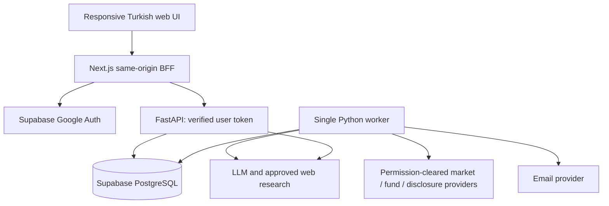

# Project 50K — System Architecture & Architecture Decision Records

**Version:** 0.4 audit revision · **Prepared:** 2026-10-02
**Status:** implementation specification / not a claim of deployed functionality.

## 1. Chosen implementation stack
Next.js App Router + TypeScript + Tailwind/custom tokens; accessible unstyled primitives; next-intl for Turkish strings. TradingView Lightweight Charts for financial series; use HTML/SVG/CSS for simple allocation visuals, not a second chart runtime in P0. Python 3.12 target + FastAPI + Pydantic; NumPy/pandas/SciPy for the initial statistical core, adding scikit-learn only for a measured challenger. PostgreSQL via Supabase; Supabase Google Auth; a single durable Python worker. Resend behind an email interface. OpenAI Responses behind a typed LLM/search interface; model ID from environment, never guessed. Vercel web, Railway API/worker, Supabase database are proposed deployments, not provisioned services [S15–S26].

The earlier Redis + pgvector + ECharts proposal is deliberately narrowed. Redis and vector search remain evolution options, not weekend prerequisites. Postgres metadata/full-text retrieval plus canonical asset/time filters are sufficient for the initial bounded corpus. Do not promise production-grade semantic retrieval without measuring it.

## 2. Deployment diagram


Use one Python package with API and worker entry points. No Kubernetes, Kafka, microservice mesh, separate graph database or general multi-agent framework in P0. React server components for public layout; client boundaries for chart/watchlist/chat. Poll existing DB-backed event APIs at a modest interval; SSE chat is optional after a working nonstreaming response.

## 3. Request/security boundary
Supabase manages Google OAuth and session cookies through current SSR guidance. Same-origin web BFF forwards the end-user access token to FastAPI. FastAPI verifies signature via issuer JWKS, expected issuer/audience, expiry and allowed algorithm. Never trust a submitted email, user ID, unsigned role or client user metadata. Reject unsafe return URLs and require CSRF/Origin checks for cookie-authenticated mutations [S16–S18].

Disable non-Google and anonymous sign-in providers for the MVP; reject anonymous and service-role tokens on user routes even if their database role appears authenticated. Resolve the current server session/identity through supported verified APIs. Local JWT validation alone does not immediately revoke an already-issued token on logout: document expiry-bounded ordinary token behavior, and check current session existence/revocation before admin, global-release and account-deletion operations. Admin membership is checked on every privileged action. Add implementation tests for these distinctions; no session integration has been exercised here.

Never share-cache SSR/BFF responses containing private data or refreshed session cookies. Preserve auth library cache headers when wrapping responses. Use verified claims/user retrieval, not a cached session object's user fields as authority. Pin the selected Supabase SSR package and test refresh/redirect/cache behavior with two users before release [S16–S18].

All product data passes through FastAPI; browser has no direct product-table CRUD. MVP API uses Supabase Data API with the verified user's JWT for user-owned rows so RLS is actually exercised. Admin operations re-check a private server-owned role record. Worker uses service credentials only server-side. Never substitute a service key for a user token in normal user requests. Public safe projections contain only published, rights-approved event fields.

Role bootstrap: verified Google identity email matched against an environment allowlist, then map to immutable user UUID in a private `admin_memberships` table. Subsequent admin authorization uses UUID membership and revocation, not just email string comparison. Allowlist updates require audit and admin session revalidation.

## 4. Worker and durable jobs
A database queue plus outbox avoids adding Redis. A private stored function claims due jobs using row locks/`SKIP LOCKED`, sets lease expiry and worker ID in the same transaction, and returns bounded batches. Completion is conditional on ownership. Expired leases retry with attempt limits. Run only one scheduled producer initially; scheduled task keys prevent duplicate jobs.

External API calls and email sends happen outside DB locks. In one transaction, publish event revision, determine eligible recipients, insert unique outbox records and advance state. On retry reuse persisted notification keys. A process-local timer is not the only durable record of pending work.

Worker types: ingestion, detector, investigation, publication, notification, digest, maintenance. Jobs reference asset/window/config/input watermark. Store error class, next retry, attempt count and safe metadata; never secrets or full private prompts.

## 5. Repository target
```text
apps/web/             Next.js frontend and BFF
apps/api/             FastAPI entry point
services/p50k/        domain, providers, detectors, decisions, AI, jobs
packages/contracts/  generated TypeScript API types
supabase/migrations/ versioned SQL including RLS
config/               reviewed defaults and capabilities
prompts/              versioned runtime prompts and coding prompts
tests/                unit, integration, contract, security, UI
research/             sources, model/data cards and experiments
docs/                 approved product and engineering specs
```
This delivery package is not that generated application. `reference/` is isolated testable specification code, not an authentication or production backend implementation.

## 6. ADR register
| ADR | Decision | Trade-off / revisit trigger |
|---|---|---|
| ADR-001 | Web MVP, API-first mobile future | Native push/background behavior deferred; revisit after product validation. |
| ADR-002 | Python intelligence + thin Next.js BFF | Two runtimes, but no duplicated business logic; share generated OpenAPI contracts. |
| ADR-003 | Managed Google Auth and DB | Faster setup, vendor dependency; entitlement/privacy review required. |
| ADR-004 | DB queue/outbox first | Good for bounded workload; Redis/queue service only after measured backlog/locking issues. |
| ADR-005 | Evidence-strength score, no pseudo-probability | Less marketable than a false certainty number; calibration later. |
| ADR-006 | No fund NAV interpolation | Accurate but not tick-like; disclose publication cadence. |
| ADR-007 | Shared events, per-user delivery policy | Reduced AI costs; private chat still isolated. |
| ADR-008 | Bounded retrieval and tool use | Lower autonomy but auditable; expand only through evals. |
| ADR-009 | Rights and data quality fail closed | Fewer live demos rather than unlicensed/misleading feeds. |
| ADR-010 | Custom design system, designer sign-off | Avoid generic dashboard aesthetics; no token choices considered approved without review. |

## 7. Dependency/version verification
Before creating lockfiles inspect official docs and package compatibility/security advisories. Next.js official source displayed 16.3.8 on 2026-10-02 [S15], but no lockfile has been generated or tested here. Pin supported runtime and resolved dependencies after install. Commit package-manager lockfiles; production builds use frozen installs. Framework-generated AGENTS.md instructions must be merged, not overwritten blindly [S20,S21].

Impeccable documentation checked on 2026-10-02 requires Node 22.18+, exceeding the observed Next.js minimum 20.9. Recheck both toolchains before installing; no lockfile or tool integration is delivered by this audit.

## v0.5 research continuation
The v0.5 proposed engine responsibilities are modules inside the existing simple API/worker stack, described in research/engine_lab/ENGINE_SYSTEM_DESIGN.md. No new service/database/agent framework is selected or implemented.

## 2026-10-03 risk review

Keep the one-codebase/worker topology; actual leases, fair scheduling, concurrent revisions and correction visibility need fault-injection acceptance. See delivery and security reviews. Current synthesis: reports/RISK_REVIEW.md; register: research/risk_review/RISK_REGISTER.json.
