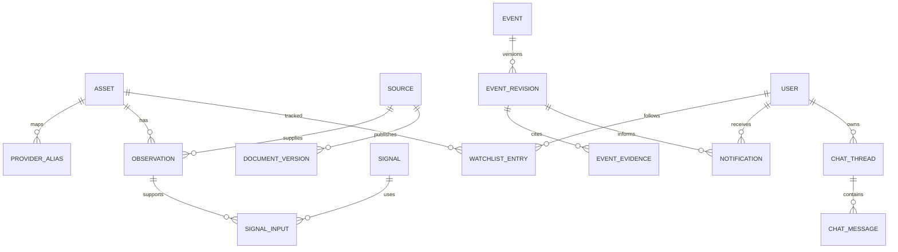

# Project 50K — Domain Model & Persistence Specification

**Version:** 0.4 audit revision · **Prepared:** 2026-10-02
**Status:** implementation specification / not a claim of deployed functionality.

## 1. Time and identifiers
Canonical entity IDs are UUIDs; examples in synthetic fixtures use fixed UUIDs. Source slugs, requirement/claim/calculation/detector/version IDs and provider external keys use their declared namespaced string formats. Store timestamps as timezone-aware UTC, not ambiguous local strings. Decimal prices, amounts and weights are decimal strings in JSON and `numeric` in SQL; never mix percentage points with fractional weights. `source_published_at`, `effective_at`, `observed_at`, `ingested_at` and `available_at` are distinct. Availability provenance says `OBSERVED`, `ARCHIVE_VERIFIED` or `UNKNOWN`.

A source with unknown historical availability cannot join a historical evidence packet. For backfilled data, ingestion time today is preserved separately from an independently verified historical availability time. Revisions never overwrite their previous values.

## 2. Entity map

## 3. Tables and required constraints
| Table | Key data | Constraints / access |
|---|---|---|
| assets | id, symbol, name, type, market, currency, identifiers, capabilities, active | Symbol alone not unique across markets. Public canonical metadata subset. |
| provider_aliases | asset_id, provider_id, external_key, network, valid_from/to | No overlapping mapping intervals for same provider/key. |
| providers | source_id, capabilities, cadence, rights, status, reviewed_at | Configuration private; expose safe coverage only. |
| observations | asset_id, source_id, type, event time, availability, revision, values, units, quality | Unique source record + revision; immutable originals; validated numeric schema. |
| document_versions | source_id, canonical_url, publisher, issuer, publication, first_seen, hash, text/excerpt rights | Content only if retention permitted; extracted claims reference version not changing URL alone. |
| signals | id, detector, config_hash, asset_id, interval, outcome, baseline, metrics, origin | FK to signal inputs; outcome includes ABSTAINED. |
| events | id, asset_id, family, dedup_key, current_revision_id | Unique dedup_key + origin namespace. |
| event_revisions | event_id, revision, title_tr, summary_tr, severity, confidence, status, evidence, timestamps | Unique event + revision; published payload immutable; nullable calibrated_probability. |
| event_evidence | revision_id, evidence_id, claim_id, role, locator, support_type | No dangling references; public URLs/source data must be display-approved. |
| profiles | user_id FK auth.users, display_name, locale, timezone | Own-row read/update only for allowed fields. Email not authority for roles. |
| watchlist_entries | user_id, asset_id, added_at | Composite uniqueness; own-row SELECT/INSERT/DELETE, no UPDATE needed. |
| notification_preferences | user_id, sensitivity, personal_email, global_critical_email, digest, quiet_hours | Own-row access; opt-in timestamps and policy version. |
| notifications | id, user_id, event_id, revision, channel, delivery_class, idempotency_key, state | Unique idempotency key; user can read/mark own item only. |
| outbox | id, notification_id, attempts, lease, provider_message_id, next_attempt, error | Worker-only writes; no browser access; durable retry state. |
| feedback | user_id, event_id, value, updated_at | Unique user + event; usefulness is not truth label. |
| chat_threads/messages | owner_id, asset_id, origin/cutoff, role, answer, citations | Own rows; no shared cache of private prompts/results. |
| private.admin_memberships | user_id, granted_by, granted_at, revoked_at | No client write; active membership checked per admin operation. |
| private.settings_versions | key, value, version, reason, actor_id, created_at | Compare-and-swap update with expected version; no arbitrary executable config. |
| private.event_release_decisions | event_id, revision, decision_id, payload/config hash, actor_id, decided_at, action, reason | Append-only approval/revocation for an exact eligible revision; admin-only. A new revision needs new approval. |
| private.audit_log | action, actor, target, old/new hashes, timestamp | Append only; no secrets; export controlled. |
| private.replay_bundles | bundle_id, cutoff, config hash, immutable source/revision manifest, rights record | Server-registered bundle only; chat/event contexts bind exact bundle. No current-web fallback. |
| private.jobs | type, payload_ref, unique_key, state, attempts, lease_until | Durable claim function; bounded retries and dead-letter state. |
| private.budget_ledger | account/user/provider/day, reserved, actual | Atomic reservations before model/search/email calls. |

## 4. RLS and authorization requirements
Use Supabase RLS on exposed tables. Default deny, explicit own-user policies with both USING and WITH CHECK. Do not put `is_admin` in writable user metadata. Service-role clients bypass RLS and therefore belong only in worker and tightly audited administrative code [S18]. The public API never exposes service keys.

Safe public data: canonical assets, rights-cleared observations needed for permitted charts and published event projections. Do not grant public SELECT on a table that also contains private raw prompts, unreleased allegations or user IDs. Prefer separate curated projection tables/API responses rather than security-definer views over mixed public/private data.

Admin metrics exclude private chat bodies by default. A settings editor accepts only an enumerated schema, validates bounds, requires reason and version, appends audit, then triggers a new config version. No SQL editor, arbitrary URLs, arbitrary prompt execution or secret viewing.

## 5. Transaction boundaries
Watchlist add is an idempotent upsert on `(user_id,asset_id)`. Event publication and outbox creation are atomic. Admin setting changes and audit are atomic. Feedback upsert is user-scoped. Read-marking cannot change notification content or recipient.

Database unique constraints, not just Python checks, enforce concurrency. Test two simultaneous delivery/create requests. Failed claims do not lose jobs; orphan leases return to retry after expiry. DB transaction success does not mean an external email was delivered: maintain `QUEUED`, `SENDING`, `ACCEPTED`, `DELIVERED`, `FAILED`, `SUPPRESSED` separately.

Global release authorization is separate from immutable event content. `global_release_approved` in an event payload is an informational snapshot, never sender authority. At enqueue and send, join the current eligible event revision to its private approval/revocation history; verify payload/config hash, current policy, origin/evidence, consent and kill switch. An update, invalidation, revocation or relevant policy change suppresses stale queued global delivery. Record a new approval for a changed revision. No migration or concurrency implementation is included here.

## 6. Proposed retention — requires legal approval
Operational content cache 7 days unless rights forbid; private chat 30 days configurable; security/audit metadata 90 days; synthetic fixtures indefinitely; source facts and derived observations only for the licensed retention period. These are proposed minimization defaults, not statutory requirements. User deletion removes personal watchlists/chats/preferences and suppresses pending mail; retain only legally justified minimal audit records with documented basis.

## 7. Migrations
Generate versioned migrations from this specification, review RLS and grants, test on a disposable Supabase-compatible database, then apply to staging with backup/rollback plan. This package deliberately does not claim a migration has been deployed. See `contracts/domain_tables.json` for machine-readable table inventory and document 20 for access tests.
