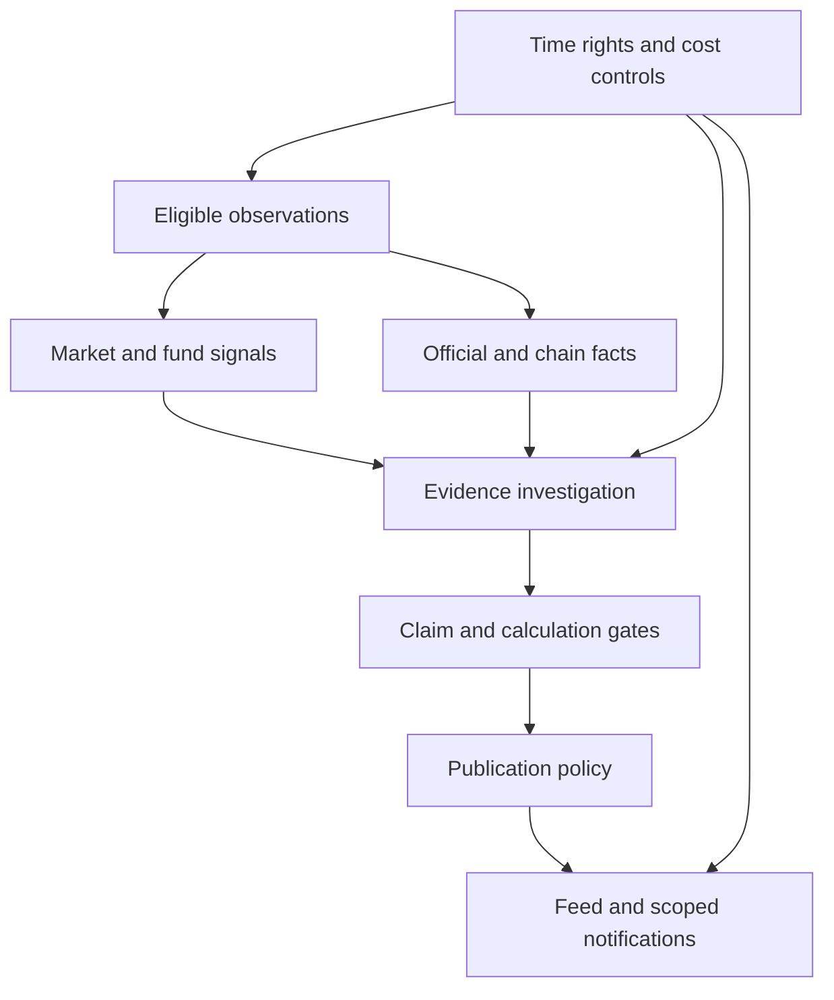

# Project 50K — Engine System Design from Research

**Date:** 2026-10-02. **Status:** implementation proposals informed by offline counterexamples and selected primary sources. This is not a delivered engine, trained predictor or calibrated detector. The 28 anomaly IDs and 284 requirement IDs remain intact and product requirements remain unimplemented.

## Product purpose and scientific target

The first defensible target is to surface an observed unusual development, classify its type, expose supporting evidence and name what is not known. Statistical rarity, financial importance, source quality, user relevance and notification eligibility are separate quantities. Price prediction, return optimization, fraud verdicts and beneficial-owner discovery are not implied by any of these experiments.

Use one Python codebase/API/worker with shared typed records and PostgreSQL jobs/outbox, as already proposed. The “engines” below are modules with separate admission conditions, not a recommendation for six microservices, extra databases or a multi-agent runtime. BIST, Turkish funds, crypto, US and meaningful on-chain remain the selected demonstration target; small active universes are a capacity choice, not accepted missing markets.

## Module responsibilities

| Module | Inputs and defensible output | Abstention / failure boundary |
|---|---|---|
| 1. Capability and knowledge-time gate | Canonical identity, venue, unit, cadence, adjustments, rights, effective/publication/availability/ingestion/revision/finality records → eligible immutable observations | Missing fields, conflicting revisions, unverified scope or future information are not zeros or normal activity. Distinguish archive reconstruction from what the system actually ingested. |
| 2. Market unusualness | Completed, same-feed observations → raw movement, session-matched volume and separately stated market context/residual | Split/feed switch, short/singular/unstable baseline or missing session calendar prevents a comparable numerical classification. A market shock may matter even when an asset residual is small. |
| 3. Fund accounting and disclosure | Dated matched net assets/NAV/unit semantics and real disclosures → endpoint residual estimate, composition change, official development | Endpoint residual is not generally exact cash flow. Investor count is not money. Allocation weight is not a trade. Missing distributions/splits/timing/scope can invalidate inference. |
| 4. On-chain observation | Verified chain/network/contract-or-mint/event identities, canonical block/signature and finality → precise finalized transfer/liquidity/control observation | A transfer is not a sale; token account/authority is not a beneficial owner. Unverified attribution, partial RPC coverage or reorgs are explicitly represented. Exact first networks remain a capability choice. |
| 5. Evidence investigation | Eligible evidence/lineage → atomic fact/derived/association/causal/absence claims, deterministic calculations, alternatives and scoped answer | Citation IDs or consistent prose do not establish support. Derived metrics cannot smuggle causal language. Unknown source lineage, mixed scopes, contradictory facts or unvalidated added prose yield partial/abstention/review. |
| 6. Publication, attention and cost policy | Validated exact event revision + user/rights/config → publish/update/invalidate, shared explanation, in-app intent, bounded chat plan, separately gated email | Large magnitude alone cannot make a global critical alert. Recheck current revision/consent/dry-run/origin at delivery. Budget exhaustion is a transparent restricted mode, not a silent invented answer. |

A disclosure or finalized transfer can be factual without enough market history for an outlier score. Conversely, a numerical outlier may be valid while its proposed cause is unsupported. Do not force every event through one weighted numerical score or demand price/volume corroboration of an official fact.

## Market methods: use context, not statistical theater

Candidate baseline: historical completed bars matched by market session/slot/venue/adjustment, with median/MAD as an inspectable robust starting point. Preserve raw movement alongside separately estimated market/sector context. Fit a market relation only on a prior eligible window; explain unstable beta and source gaps. Exact window/thresholds are provisional, including current RVOL3/z4 defaults.

The market simulation gives a useful positive control and a flat-volume negative control: season matching helps the constructed U-shaped market but not the flat control. It also shows a stable-beta residual helping distinguish market-wide from idiosyncratic movement, and a beta-shift counterexample where that approach fails. Therefore keep these as contextual features with admission checks, not automatic suppression of all broad-market events.

Multiple-testing correction is not available just because a robust score has a number. BH/BY need valid null tail probabilities and a defined test family; financial dependence, heavy tails, drift and repeated monitoring matter. The heavy-tail counterexample deliberately violates Gaussian p-values and defeats both corrections. Daily false-alert burden, event deduplication and baseline-validity checks remain necessary. No confidence/probability field should be populated from these simulations.

## Fund semantics: name the estimated quantity

For matched unadjusted NAV and net asset scope, `A_t − A_(t−1) × P_t/P_(t−1)` equals end-period NAV times change in units. It is a cash estimate only under additional transaction-price/timing assumptions. Splits, reinvested distributions, transferred units, total-return versus raw NAV and mismatched dates/scope need explicit handling. Unit identity is a useful audit cross-check, not proof that the provider fields are correct.

Store method, input dates, net/gross scope, raw/adjusted/total-return NAV semantics, unit/split/distribution convention and uncertainty with a derived residual. If required semantics are missing, retain separate dated AUM/NAV facts or abstain; do not present a strong outflow narrative. A fund-specific disclosure/composition path remains useful when AUM/investor history is unavailable.

Where inputs have known bounded measurement error, propagate interval bounds and mark threshold straddling as unresolved. This is a sensitivity interval, not a statistical confidence interval. Allocation differences describe composition; proving trades needs security quantities, prices, distributions, corporate actions and cash-flow evidence at compatible times.

## Two replay questions

1. **Actual-system replay:** what facts and source revisions had the engine actually ingested by the cutoff? This can reproduce its recorded decisions if code/config/rights/evidence are retained.
2. **Source-available reconstruction:** what independently verified contemporaneous archive material could have been known? This can support a carefully labeled historical experiment, not a claim that the prototype detected the event live.

A late backfill can extend an archival reconstruction but must make a new bundle. It cannot rewrite the previous actual-system manifest. Freeze detector/scoring config with evidence; an unchanged evidence bundle evaluated under a different threshold is a different experimental context. A publication date alone does not establish the historic text/version was available.

The temporal lab only verifies local state transitions and frozen records. Consensus, RPC coverage, provider truth, database transactions and real delivery concurrency still need integration tests. Production schemas need a reviewed knowledge-basis representation before the UI makes stronger replay claims; the lab does not silently extend current PublicEvent/AIAnswer contracts.

## Investigation and rendering

A staged read-only workflow is preferable to unbounded agent recursion: retrieve known evidence → ask precise remaining questions → bounded lookup → calculate → draft typed claims → gate dependencies/scope/lineage/contradictions → render supported claims and named limitations. Share eligible event explanations by evidence/config version rather than making a new model call for each watcher. Private questions still use the authenticated user context and quotas.

The evidence lab's typed atoms, lineage and authenticity are supplied by hand. It demonstrates why existence-only and weak scope policies fail, not that semantic extraction works. A closed renderer can prevent extra unvalidated sentences in its own fixture language; a production natural-Turkish LLM response still requires actual extraction/reviewer output schemas and independent claim-level evaluations. Two genuinely distinct sources can agree on a false fact. Corroboration lineage measures distinct origins, not causal/statistical independence or world truth.

Keep current heuristic `Kanıt gücü` and its components clearly labeled; it remains neither calibrated truth probability nor price risk. Test source support, arithmetic correctness, completeness and truth where independently available as separate metrics. A polished answer with no cited falsehood can still omit the crucial contradiction or overstate causality.

## Attention and cumulative cost

Merge correlated features within an asset/observation interval into one candidate. Episode grouping is a useful hypothesis but needs causal streaming validation; the market lab's known-event oracle is not a deployed clustering algorithm. A long blind cooldown can suppress a distinct new material event. Updates/corrections need material-change semantics and exact revision identity.

Budget is TRY 5,000 total project spend, excluding only development Claude/Codex subscriptions. Runtime inference/search, data and hosting count toward it. No quoted plan or operating lifetime was verified. Reserve cost before calls, keep bounded tool/time/source limits, reconcile uncertain provider outcomes conservatively and cache only within rights/context/revision rules. The evidence lab's budget units/tokens/durations are invented scenarios, not actual latency, token measurements or TRY prices. No test proves affordability.

## Evaluation ladder before stronger claims

1. Provider capability/rights and independent data-quality checks.
2. Counterexamples, arithmetic/temporal invariants and provenance contracts.
3. Licensed point-in-time replay with frozen cohorts/constituents/revisions, prior-only baselines and untouched evaluation periods.
4. Alert-level labels and user comprehension; distinguish rarity, factual support, usefulness and actual financial harm.
5. Quiet prospective operation/shadow review, rate per eligible asset-day, episode deduplication, coverage gaps and cost accounting.
6. Only then reviewed measured error/calibration artifacts for the precise target and population.

Use walk-forward evaluation and dependency-aware uncertainty where appropriate; fit/select on earlier data and freeze the later evaluation. Include ordinary periods, market-wide shocks, stale sources, missingness and base rates, not only hand-picked crisis stories. No fixed minimum sample count is invented for all markets/events. No source or synthetic result validates the catalog's 28 thresholds or a full MVP.

## What to retain, reject or defer

Use HYPOTHESES.json and the detailed engine lab reports for evidence and conditions. Retain inspectable context/quality/time/claim gates; reject the disproven general interpretations (cash from count, transactions from weights, truth from source-ID existence, present rows as actual past knowledge). Defer learned models, financial p-values/FDR/calibration, production semantic extraction, entity attribution and public-release performance claims until their required data and evaluation exist. Defer the method, not the owner's required market/on-chain experience.
